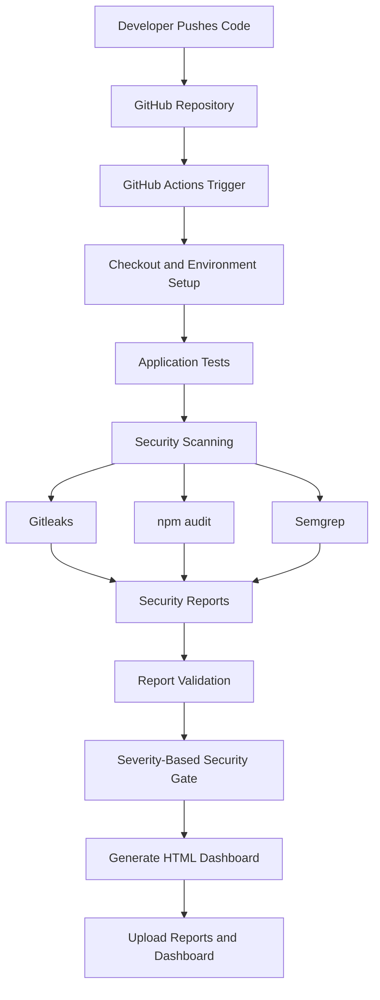

# Secure CI/CD Pipeline Using DevSecOps

## 1. Project Overview

This project demonstrates the implementation of a DevSecOps-based CI pipeline using GitHub Actions.

The main objective is to integrate automated security scanning into the software development lifecycle (SDLC), identify potential security issues early, and enforce security policies before code progresses further.

The pipeline combines automated application testing, dependency scanning, static code analysis, secret detection, and a severity-based security gate.

## 2. Problem Statement

Traditional development workflows often perform security checks separately or at later stages.

This can result in:
- Late detection of security vulnerabilities.
- Exposure of sensitive information.
- Vulnerable third-party dependencies.
- Lack of centralized security reports.
- Inconsistent security enforcement.

Our project addresses these challenges by integrating automated security checks into a GitHub Actions workflow.

## 3. Project Objectives

- Automate application testing through CI.
- Detect exposed secrets using Gitleaks.
- Identify vulnerable dependencies using npm audit.
- Perform static code analysis using Semgrep.
- Generate machine-readable security reports.
- Enforce severity-based security policies.
- Display scan results through an HTML dashboard.

## 4. System Architecture

## 5. Tools and Technologies

| Technology | Purpose |
|---|---|
| Git and GitHub | Version control and repository management |
| GitHub Actions | CI workflow automation |
| Node.js | Application execution and testing |
| JavaScript | Application and security gate logic |
| npm audit | Dependency vulnerability scanning |
| Semgrep | Static Application Security Testing (SAST) |
| Gitleaks | Secret detection |
| HTML and CSS | Security dashboard |

## 6. Security Scanning Modules

### A. Secret Detection - Gitleaks

Gitleaks scans repository content and Git history for exposed secrets and credentials.

### B. Dependency Scanning - npm audit

npm audit checks project dependencies against known vulnerability information and generates a JSON report.

### C. Static Code Analysis - Semgrep

Semgrep analyses source code for potentially insecure coding patterns and generates a machine-readable report.

## 7. Severity-Based Security Gate

The security gate reads the generated npm audit and Semgrep reports.

Current security policy:

| Finding | Decision |
|---|---|
| npm Low | Pass |
| npm Moderate | Pass |
| npm High | Block |
| npm Critical | Block |
| Semgrep ERROR | Block |
| Semgrep WARNING | Pass |
| Semgrep INFO | Pass |

Missing, invalid, or incomplete scan reports also prevent the security gate from passing.

## 8. Security Dashboard

The project includes an automatically generated HTML dashboard.

It displays:
- npm dependency vulnerability counts.
- Semgrep ERROR, WARNING, and INFO findings.
- Gitleaks scan status.
- Security gate status.
- Availability of scan reports.

The dashboard is generated from the JSON reports produced during the GitHub Actions workflow and uploaded as a downloadable artifact.

## 9. Current Implementation

The following components have been integrated:

- GitHub Actions workflow triggered on code push.
- Node.js application testing.
- Gitleaks secret scanning.
- npm audit dependency scanning.
- Semgrep static code analysis.
- JSON security report validation.
- Severity-based security gate.
- Automated HTML dashboard generation.
- Security report and dashboard artifact upload.

## 10. Current Limitations

- The College Management Application has not yet been integrated.
- Container image scanning is not currently implemented.
- Actual deployment automation is not currently implemented.
- Advanced security evaluation and failure-scenario testing remain future work.

## 11. Future Scope

- Integrate the College Management Application.
- Add container security scanning using Trivy.
- Extend security evaluation with detection rate, false positives, gate accuracy, and execution overhead.
- Improve dashboard reporting and visualization.
- Explore deployment integration after security validation.

## 12. Conclusion

This project demonstrates how security checks can be integrated into an automated CI workflow using DevSecOps principles.

By combining secret detection, dependency scanning, static code analysis, report validation, and policy-based security enforcement, the pipeline provides an organized approach to identifying potential security issues early in the development process.
